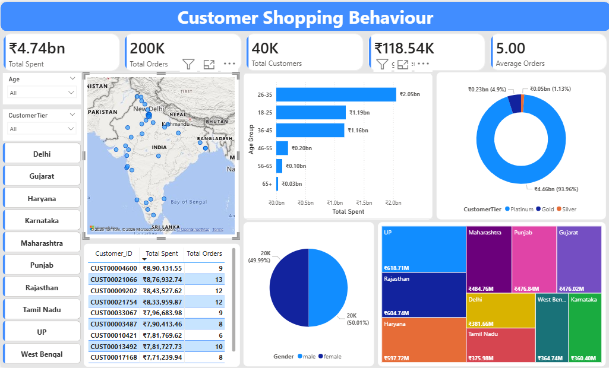

# Customer Shopping Behaviour Analysis

End-to-end analysis of a 40,000-customer retail dataset (India): Python EDA in a Jupyter notebook, plus an interactive Power BI dashboard.

## Goal
Understand who the high-value customers are and where revenue comes from, across gender, age group, loyalty tier and geography.

## Tools
Python (pandas, NumPy, matplotlib, seaborn) · Jupyter Notebook · Power BI

## Dataset
40,000 customers, 13 columns: demographics, city/state, registration date, loyalty tier (Silver / Gold / Platinum), total orders and total spent. Registrations span June 2023 – May 2024.
The data is synthetic/sample data. Email and phone columns were dropped before analysis and are not included in this repo.

## Project structure
```
├── notebooks/Customer_shopping_behaviour_analysis.ipynb
├── dashboard/CustomerShoppingBehaviour.pbix
├── dashboard/screenshots/        <- dashboard images
├── data/customers.csv            <- cleaned data (no email/phone)
└── README.md
```

## What I did
1. **Cleaning:** dropped PII columns, checked nulls, fixed date and pincode types.
2. **EDA:** spend and orders by gender, age group, tier, state and city; top 15 customers (grouped by Customer_ID, since names are not unique: 927 distinct names across 40,000 customers).
3. **Outliers:** IQR method flagged 1,319 high spenders, all Platinum. Kept them as genuine high-value customers, not errors.
4. **Zero-spend customers:** 274 customers (all Silver) have no purchases. Worth treating separately from low spenders.
5. **Correlation:** Total_Orders vs Total_Spent is moderate (0.49); age has a weak negative link with spend (-0.25).
6. **Dashboard (Power BI):** KPI cards, state slicer, city map, age/tier/gender charts, top-10 customers table.

## Key findings
- Gender is not a differentiator: male and female customers contribute almost equally to spend.
- Platinum is the top-spending tier by a wide margin.
- Ages 26-35 contribute the most total revenue (~₹2.05B). Average spend per customer is similar for 26-35 and 36-45 (~₹146K) and drops to ~₹41K after age 45.
- Uttar Pradesh, Rajasthan and Haryana are the top states by total spend.

## Dashboard preview


## How to run
1. Clone the repo.
2. `pip install pandas numpy matplotlib seaborn jupyter`
3. Open the notebook and run all cells (it reads `data/customers.csv`).
4. Open the `.pbix` in Power BI Desktop (free).

## Limitations / next steps
- Spend is lifetime total, so there is no time-based revenue trend.
- No formal segmentation (e.g. RFM or clustering) yet, which is a natural next step.

## Author
Adi · B.Tech CS, Jamia Hamdard · [Portfolio](https://adikhalid48-sketch.github.io)
